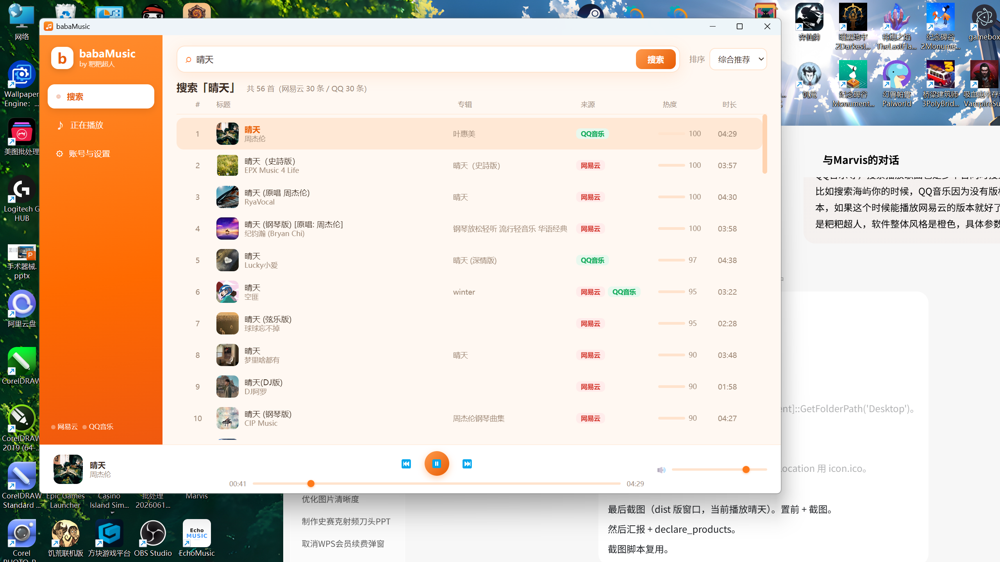

# BBMusic

多平台聚合音乐播放器 · Electron + 原生 JS（无前端框架）

一次搜索聚合 **网易云音乐 / QQ 音乐 / 酷我音乐** 三个平台的曲库，任一平台拿不到音源（会员专享、版权下架）时，自动去 **B 站** 检索同一首歌作为兜底播放源。

作者：**粑粑超人** ｜ 当前版本：**1.0.0** ｜ 平台：Windows x64



## 功能特性

- **聚合搜索**：一次输入聚合多平台结果，按歌手/歌名匹配度加权排序，附评论数（支持「1W+」等中文单位）与热度
- **多源取链**
  - 网易云：eapi 加密取链，登录后可取 320k
  - QQ 音乐：`musicu.fcg` → `music.vkey.GetVkey`，按 `media_mid` 拼 filename 取 purl，并用 Range 实测校验直链真伪
  - 酷我：`antiserver` 签名取链 + 试听片段时长探测（低于 70% 判定为截断片段直接丢弃）
- **B 站兜底音源**：标题含完整歌名 + 歌手名匹配 + 时长容差 3.5% + 排除翻唱/伴奏/live/片段等非原版标记，四条全过才使用，宁可播不出也不播错歌
- **登录态检测**：网易云 / QQ 音乐 Cookie 登录，三态指示灯（有效 / 失效 / 异常），结果落盘缓存 24 小时，可在设置页手动强制刷新
- **歌单导入**：粘贴网易云 / QQ 音乐分享链接（支持整段分享文案、短链），自动识别平台并导入
- **本地歌单与历史**：我的歌单（含默认歌单）、播放历史（最多 100 首，分页 30）
- **桌面歌词**：独立透明无边框窗口，逐字节奏、锁定鼠标穿透、可调字体/颜色/动效，失焦不影响主窗
- **断点续播**：关闭时记住歌曲、进度与所在歌单，下次启动自动定位到上次停下的秒数，并按原播放模式续播
- **其他**：音质档位、音频本地缓存（可自定义缓存目录/容量清理）、音量记忆、四种播放模式、关闭行为设置

## 目录结构

```
babaMusic/
├─ main.js                  主进程：搜索聚合、取链调度、设置、桌面歌词窗、歌单导入、缓存
├─ preload.js               暴露 window.baba 安全桥
├─ apis/
│  ├─ netease.js            网易云 eapi 取链
│  ├─ qq.js                 QQ 音乐 vkey 取链
│  ├─ kuwo.js               酷我 antiserver 签名取链
│  ├─ bili.js               B 站兜底音源（wbi 签名 + 多条件校验）
│  └─ crypto.js             签名工具
└─ renderer/
   ├─ index.html            侧栏五视图：搜索 / 歌单 / 播放历史 / 正在播放 / 设置
   ├─ app.js                渲染层主逻辑
   ├─ rank.js               排序内核（主进程与渲染层共用同一套打分公式）
   ├─ lyric.html/js/css     独立桌面歌词窗
   └─ style.css             主窗样式
```

## 下载与安装

到 [Releases](https://github.com/March886/bbmusic/releases) 下载最新安装包：

| 文件 | 用途 |
| --- | --- |
| `BBMusic-1.0.0-win-x64-setup.exe` | Windows x64 安装包，双击按向导安装 |
| `latest.yml`、`*.blockmap` | 客户端自动更新的索引与差量文件，**不用手动下载** |

- 安装位置：`%LOCALAPPDATA%\Programs\BBMusic`（用户级，无需管理员）
- 用户数据：`%APPDATA%\bbmusic\bbmusic.json`，卸载不删除，覆盖安装保留歌单与设置
- 已装老版本无需卸载，直接跑新安装包即可覆盖升级；装好后启动时会自动检查更新

## 本地运行

```powershell
npm install
npm start
```

> 如需调试：`electron . --remote-debugging-port=9222`，通过 CDP 的 `/json/list` 抓页面。

## 打包（NSIS 安装包）

```powershell
$env:CSC_IDENTITY_AUTO_DISCOVERY="false"   # 未做代码签名，跳过自动签名探测
npm run dist
```

- 产物：`dist\BBMusic-<version>-win-x64-setup.exe`
- 安装位置：`%LOCALAPPDATA%\Programs\BBMusic`（用户级，无需管理员）
- 用户数据：`%APPDATA%\bbmusic\bbmusic.json`，卸载不删除，覆盖升级保留歌单与设置

## 已知限制

- 三个平台的接口均为非官方公开接口，随时可能变更或失效，失效后需自行适配
- 未做代码签名，首次运行会出现 SmartScreen 提示。介意的话可在「更多信息 → 仍要运行」放行，或自行用证书重签
- 音源来自第三方平台公开接口，能否播放取决于各平台的版权与会员策略；播放器只做取链与播放，不存储、不分发任何音频文件

## 免责声明

本仓库**不包含任何音频文件或音乐内容**，仅包含播放器客户端代码；所有搜索结果与播放地址均实时来自第三方平台的公开接口，版权归各平台与版权方所有。

本项目仅供**学习与技术研究**使用，请勿用于商业用途或公开再分发。请支持正版音乐。

## License

[MIT](LICENSE)
